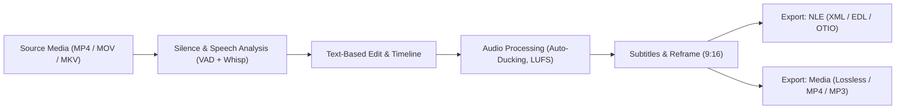
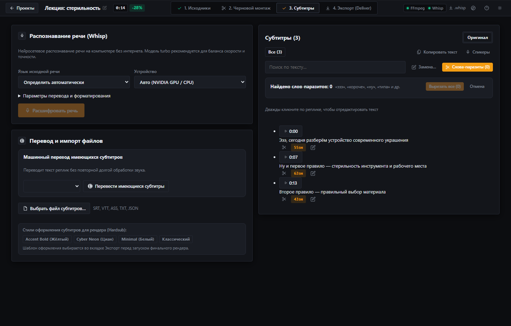

<p align="center">
  
</p>

<h1 align="center">WHISP MEDIA DESK</h1>

<p align="center">
  Standalone desktop application for voice-based video editing, automated silence removal, and synchronized subtitle generation powered by <a href="https://github.com/DmitryLeLeE/whisp">Whisp</a>.
</p>

<p align="center">
  <a href="https://github.com/DmitryLeLeE/whisp_desk/releases"></a>
  
  
  
  
  <a href="https://github.com/DmitryLeLeE/whisp"></a>
  
  
  <a href="LICENSE"></a>
</p>

<p align="center">
  <a href="README.md">Русский</a> • <b>English</b>
</p>

---

**Whisp Media Desk** is an offline desktop workstation designed for automating rough-cut video editing, podcasts, interviews, and educational content. The application analyzes audio tracks using local Faster-Whisper models and voice activity detection (VAD), identifies speech pauses and stutters, enables editing video footage directly through transcript text, cleans filler words, mixes background music with sidechain auto-ducking, generates word-synchronized subtitles, and exports timelines to professional NLEs (Adobe Premiere Pro, DaVinci Resolve, Final Cut Pro) or renders directly via FFmpeg.

> [!NOTE]
> **Privacy and Offline Execution**: The application requires no cloud accounts, subscriptions, or external network connectivity. All speech recognition, audio processing, and video rendering are performed locally on your workstation. The internal HTTP server binds strictly to `127.0.0.1`.

---

## Architecture and Workflow



---

## Pro NLE Workstation Interface

Engineered following professional non-linear editing paradigms (DaVinci Resolve Studio, Apple Final Cut Pro): edge-to-edge layout (`100vw × 100vh`) with no wasted web margins, four dedicated studio rooms (`Media Setup` → `Cut Room` → `Caption Studio` → `Deliver Room`), dual-deck layout with program video monitor and decision inspector, full-width multi-track timeline, and hardware stereo VU meter.

| Dual-Deck Cut Workstation & Full-Width NLE Timeline | Assembly Pattern Presets (Shorts, Podcast) |
|:---:|:---:|
|  |  |

| Caption Studio with Teleprompter & Diarization | Deliver Room & Audio Mastering |
|:---:|:---:|
|  |  |

<details>
<summary>Additional Screens (Project Manager, Light Theme, Setup, Neural Models)</summary>

| Project Manager (DaVinci Media Pool Style) | Project Manager in Light Theme (Final Cut Slate) |
|:---:|:---:|
|  |  |

| Light Theme Timeline Workstation | Media Setup & Acoustic Analysis Room |
|:---:|:---:|
|  |  |

| Local Neural Model Management |
|:---:|
|  |

</details>

---

## Comparison with Alternative Solutions

| Parameter | Whisp Media Desk | Cloud Editors (Descript, CapCut, Opus) |
|---|---|---|
| Data Processing | Strictly local on user machine (no network egress) | Uploads media to external cloud servers |
| Pricing Model | Free and open source (MIT license) | Monthly recurring subscriptions ($20–$50/mo) |
| Duration Limitations | Unrestricted duration and file sizes | Monthly minute quotas on processing |
| NLE Timeline Export | Premiere XML, DaVinci FCPXML, EDL, OTIO | Restricted or locked behind paid tiers |
| Stream Copy Export | Supported (Lossless Cut, `-c copy`) | Not supported (full transcode required) |
| Background Music Ducking | Built-in FFmpeg Sidechain compressor | Basic mix or manual keyframing |
| Word-by-Word Subtitles | ASS / SRT / VTT with configurable styling | Generic templates with watermarks on free tiers |
| Project Storage Format | Portable `.whisp` bundles (< 200 KB) | Locked inside proprietary cloud platforms |

---

## Core Features

### 0. Pro NLE Workstation Architecture (DaVinci Resolve / Final Cut Pro)
* **Edge-to-Edge Desktop Shell**: 100% viewport space utilization (`100vw × 100vh`) with zero web sidebars or vertical window scroll.
* **Studio Workspaces (DaVinci Workflow)**: Dedicated rooms: `[ 1. Media Setup ]`, `[ 2. Cut & Edit ]`, `[ 3. Caption Studio ]`, and `[ 4. Deliver ]`.
* **Dual-Deck Cut Room**:
  * Program Monitor with `● REC` indicator, frame-stepping transport console (`◀` / `▶`), monospace LCD timecode, and live subtitles overlay.
  * Inspector & Decision List placed side-by-side with video monitor for instant click-to-seek navigation.
  * Multi-track NLE Timeline spanning 100% window width (`TC`, `V1`, `A1`, `T1`) with acoustic waveform and color-coded cuts.
* **Stereo Peak VU Meter**: Real-time dB response (−42 dB .. 0 dB) with peak clipping indicator.
* **Project Manager (Media Pool)**: Fast media hub with instant search, sorting, and cinematic drag-and-drop ingestion.

### 1. Automated Rough-Cut Assembly
* Multi-stage voice activity detection (Silero VAD combined with energy thresholding).
* Accurate boundary detection for pauses between words and sentences.
* Assembly presets:
  * **Dynamic Cut (Shorts / Reels)** — removes pauses longer than 250 ms for fast pacing.
  * **Podcast & Dialogue** — preserves natural breathing while capping silence at 500 ms.
  * **Lecture & Presentation** — aligns cuts with logical presentation segments.
  * **Retake Removal** — detects repeated phrasing attempts and cuts false starts.
  * **Pause Compression** — shortens extended silences to a target window (300–400 ms).
  * **Highlights & Teaser** — extracts core key statements for 30, 60, or 90-second teasers.

### 2. Instant Lossless Cut (Stream Copy)
* Exports video and audio streams without re-encoding (`-c copy`) in 2–4 seconds.
* Slices media at keyframes (I-frames) via FFmpeg concat demuxer without quality loss.
* Enabled with a single toggle in the export panel.

### 3. Text-Based Editing & Speech Cleanup
* Edit video footage directly from the transcript: clicking sentences or words toggles their inclusion on the timeline.
* Automatic detection and batch removal of filler words (*"uh"*, *"um"*, *"like"*, *"you know"*).
* Custom terminology and proper name dictionary support (`initial_prompt`) to prevent transcription errors.

### 4. Speaker Diarization
* Local spectral feature extraction (fundamental frequency F0, spectral centroid, rolloff, formants).
* Unsupervised KMeans clustering of speech turns with silhouette confidence scoring.
* Visual speaker tags in the subtitle panel with single-click reassignment.

### 5. Razor Tool & Storyboard Reordering
* Split active segments at the current playhead position using shortcut keys <kbd>C</kbd> or <kbd>B</kbd>.
* Reorder narrative blocks using <kbd>▲</kbd> and <kbd>▼</kbd> buttons in the decision table with automatic sequence preservation during rendering.

### 6. Synchronized Subtitles with Word Highlighting
* Word-level timing generated from Whisp transcription timestamps.
* Real-time word highlighting synchronized with spoken cadence.
* Built-in display styles:
  * **High-Contrast (Shorts / Reels)** — bold typography, heavy stroke, and drop shadow.
  * **Neon Accent** — vivid text with soft glowing outline.
  * **Minimal** — clean typography with subtle backdrop box.
* Output formats include styled ASS, SRT, VTT, and burned-in video hardsubs.

### 7. Background Music with Auto-Ducking
* Seamless audio track looping throughout video duration (`-stream_loop -1`).
* Hardware sidechain compression via FFmpeg: automatically lowers music level during dialogue and recovers during natural pauses.
* Configurable ducking threshold, attack/release times, and volume balance.

### 8. Smart Face Reframe (9:16 Auto-Crop)
* OpenCV-based face detection on speech segments.
* Calculates smooth horizontal panning offsets to convert standard widescreen (16:9) into mobile vertical formats (9:16).

### 9. Batch Processing Queue
* Multi-file ingest for sequential unattended processing.
* Select processing profiles per project with background worker tracking and progress indicators.

### 10. Show Notes & Publishing Metadata
* Generates publishing summaries from the final transcript:
  * **YouTube**: formatted descriptions with clickable timestamp chapters.
  * **Telegram / Social**: structured posts with key takeaways and bullet points.
* Single-click clipboard copy.

### 11. Audio Mastering & Normalization
* Standardized loudness normalization adhering to **EBU R128 (LUFS)**:
  * `-14 LUFS` — YouTube, Shorts, TikTok, Reels.
  * `-16 LUFS` — Podcasts, Spotify, Apple Podcasts.
  * `-23 LUFS` — Broadcast television and radio standards.
* Spectral noise reduction filter (`afftdn`) to remove microphone hiss and ambient fan noise.
* Built-in 8 ms declicker to eliminate boundary pops on cut points.

### 12. Portable Project Bundles (.whisp)
* Archive timeline edits, decision states, markers, and subtitles into a ZIP package (`.whisp`) under 200 KB.
* Enables sharing project edits between editors without duplicating source media.

---

## NLE Timeline Export Compatibility

| Software | File Format | Exported Elements |
|---|---|---|
| Adobe Premiere Pro | Final Cut Pro 7 XML (`xmeml v5`) | Video and audio tracks, cut points, timecodes, source links |
| DaVinci Resolve | FCPXML 1.9 + Markers CSV | Cut timeline, color-coded speech and silence markers |
| Apple Final Cut Pro | FCPXML 1.9 | Native project structure with spine sequencing |
| Kdenlive / Avid / Vegas | CMX 3600 EDL | Standard edit decision list |
| Studio Pipelines | OpenTimelineIO (`.otio`) | Modern open industry interchange format |
| YouTube | Smart Chapters (`.txt`) | Formatted timestamp list for video descriptions |

---

## Keyboard Shortcuts

| Shortcut | Action |
|---|---|
| <kbd>Space</kbd> | Play / Pause |
| <kbd>J</kbd> / <kbd>K</kbd> / <kbd>L</kbd> | Shuttle Rewind / Pause / Fast Forward |
| <kbd>←</kbd> / <kbd>→</kbd> | Frame step with audio scrubbing |
| <kbd>Q</kbd> / <kbd>W</kbd> | Ripple trim start / end to current playhead |
| <kbd>S</kbd> / <kbd>C</kbd> / <kbd>B</kbd> | Split segment at playhead (Razor Cut) |
| <kbd>I</kbd> / <kbd>O</kbd> | Set In / Out range markers |
| <kbd>M</kbd> | Place timeline marker with note |
| <kbd>~</kbd> / <kbd>F11</kbd> | Fullscreen monitor toggle |
| <kbd>R</kbd> | Mark segment reviewed |
| <kbd>Enter</kbd> | Accept decision and advance to next segment |
| <kbd>Ctrl</kbd> + <kbd>Z</kbd> | Undo last action |
| <kbd>Ctrl</kbd> + <kbd>Shift</kbd> + <kbd>Z</kbd> | Redo action |
| <kbd>?</kbd> | Open keyboard shortcuts reference |

---

## Installation and Setup

### Method 1: Pre-built Windows Executable (Recommended)

1. Open the [Releases](../../releases) page and download `WHISP_MEDIA_DESK.exe` (or installer setup).
2. Place the binary in your preferred directory (all configuration and projects persist in local `projects/` and `config/` folders).
3. Run the executable to open the native WebView2 interface.
4. All dependencies (FFmpeg, Faster-Whisper models) run self-contained.

> [!NOTE]
> **Windows SmartScreen Notice**:
> Because Whisp Media Desk is an open-source tool distributed without an expensive corporate Microsoft code signing certificate, Windows SmartScreen may present an informational prompt on first launch. Click **More info** and select **Run anyway** to proceed.

---

### Method 2: Running from Source

Prerequisites: **Python 3.11+**, **Node.js 18+**, and **FFmpeg** available in your system `PATH`.

```bash
# Clone the repository
git clone https://github.com/DmitryLeLeE/whisp_desk.git
cd whisp_desk

# Install dependencies and build frontend assets
setup.bat

# Launch the desktop workstation
run.bat
```

---

## Development & Automated Testing

```bash
# Run backend test suite (98 tests)
cd backend && pytest tests

# Run backend server in standalone headless mode
python -m app.main --no-window

# Run frontend development server with hot-reload
cd frontend && npm run dev
```

---

## License

This project is licensed under the [MIT License](LICENSE).

Third-party open-source components:
* **Whisp** (faster-whisper) — MIT License.
* **FFmpeg** — LGPL / GPL License.
* **Auto-Editor** — Unlicense.
* **FastAPI** — MIT License.
* **React** — MIT License.
