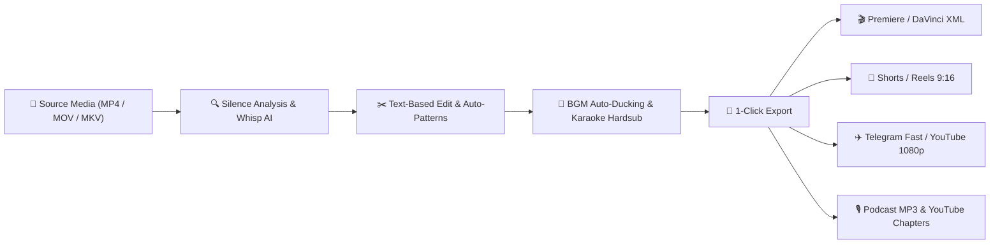
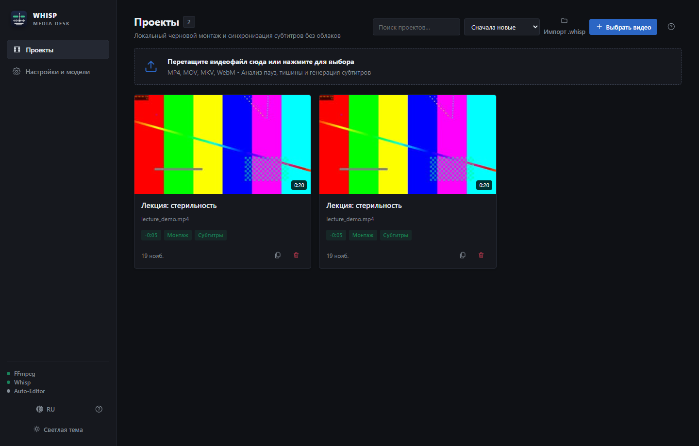
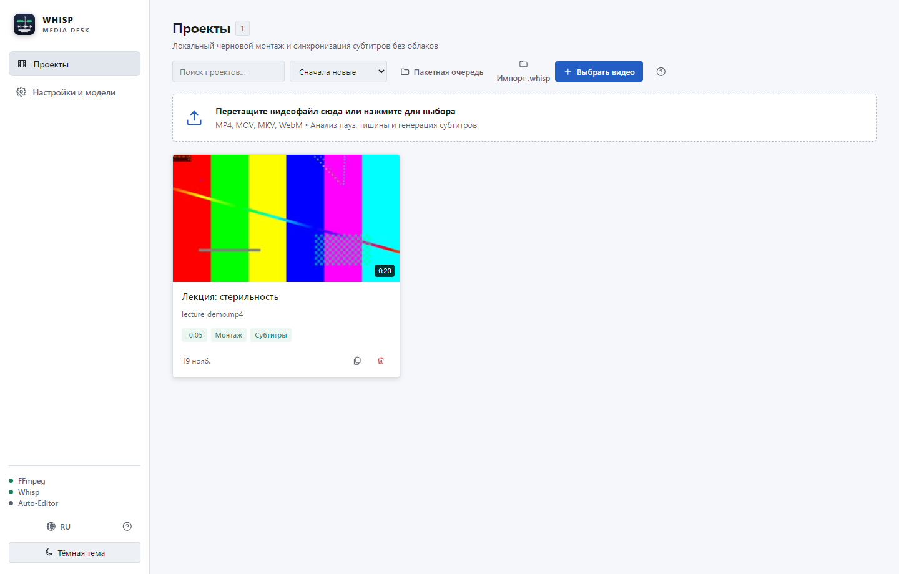

<p align="center">
  
</p>

<h1 align="center">WHISP MEDIA DESK</h1>

<p align="center">
  <b>Professional local studio for automated video editing, speech processing, and viral subtitles powered by <a href="https://github.com/DmitryLeLeE/whisp">Whisp</a></b>
</p>

<p align="center">
  <a href="https://github.com/DmitryLeLeE/whisp_desk/releases"></a>
  
  
  
  
  <a href="https://github.com/DmitryLeLeE/whisp"></a>
  
  
  <a href="LICENSE"></a>
</p>

<p align="center">
  <a href="README.md">🇷🇺 Русский</a> • <b>🇬🇧 English</b>
</p>

---

**WHISP MEDIA DESK** is an offline desktop workstation for content creators, podcasters, educators, and video editors. It automates rough-cut editing: detects silences and stutters, enables text-based video editing, cleans filler words, mixes background music with smart auto-ducking, burns animated word-by-word karaoke subtitles, generates YouTube chapters, and exports directly to Adobe Premiere Pro, DaVinci Resolve, Final Cut Pro, and MP4/MP3.

> [!IMPORTANT]
> **100% Privacy & Offline Execution**: No subscriptions, no cloud servers, no hidden telemetry, and no video length limits. All AI transcription (Faster-Whisper) and video rendering (FFmpeg) run locally on your own machine. The backend is sandboxed to `127.0.0.1`.

---

## 🚀 Architecture & Workflow



---

## 📸 App Screenshots

| Interactive Studio Timeline (Audio Scrubbing) | Auto-Pattern Assembly Studio |
|:---:|:---:|
|  |  |

| Text-Based Editing & Filler Words Cleaner | Export (Social Presets, BGM, NLE, Chapters) |
|:---:|:---:|
|  |  |

<details>
<summary><b>Expand other screens (Light Theme, Projects, Setup, Models)</b></summary>

| Dark Studio Theme (Slate) | Light Studio Theme (Canvas) |
|:---:|:---:|
|  |  |

| Light Theme Timeline Editor | Analysis Profiles Setup |
|:---:|:---:|
|  |  |

| Local Whisp Models Management |
|:---:|
|  |

</details>

---

## ⚡ Comparison with Cloud Solutions

| Capability | WHISP MEDIA DESK | Cloud Editors (Descript, CapCut, Opus) |
|---|:---:|:---:|
| **Privacy & Security** | 🛡️ **100% Offline on your PC** | ❌ Video uploaded to external servers |
| **Pricing / Subscription** | 🆓 **Free Forever (MIT License)** | ❌ Monthly subscription ($20–$50/mo) |
| **Duration Limits** | ♾️ **Unlimited (even 10+ hours)** | ❌ Strict minute caps per month |
| **NLE Timeline Export** | 🎬 **Premiere XML, DaVinci FCPXML, EDL, OTIO** | ⚠️ Restricted or premium-only |
| **BGM + Auto-Ducking** | 🎵 **Built-in (FFmpeg Sidechain)** | ⚠️ Basic or manual |
| **Word-by-Word Karaoke Subs** | ✨ **MrBeast, Neon, Minimal styles** | ⚠️ Generic templates with watermarks |
| **Portable Project Bundles** | 📦 **.whisp bundles (<200 KB)** | ❌ Locked inside proprietary cloud |

---

## 🔥 Key Features

### 1. ⚡ Auto-Pattern Studio
One-click rule-based assembly algorithms for fast rough-cut workflows:

| Pattern | Description | Best For |
|---|---|---|
| **⚡ Dynamic Shorts / Reels** | Jump-cut editing cutting micro-pauses and removing filler words | TikTok, Reels, Shorts |
| **🎙️ Podcast & Dialogue** | Natural breathing rhythm, gentle pauses (500ms), zero harsh transitions | Podcasts, discussions |
| **🎓 Lecture with Slides** | Syncs cut points with scene and slide transitions | Webinars, course videos |
| **🧹 Retakes & Stumble Remover** | Identifies repeated spoken attempts using transcript and removes failed takes | Unscripted recordings |
| **⏱️ Silence Compressor** | Shortens prolonged dead air to a comfortable 350ms duration | Long lectures |
| **🔥 Teaser / Highlight Reel** | Extracts high-energy key statements into a 30s, 60s, or 90s teaser | Promos, trailers |

---

### 2. 🎵 Background Music with Smart Auto-Ducking
* Seamless looping of any soundtrack (`-stream_loop -1`).
* **Sidechain Compression**: music dynamically and smoothly attenuates by 7x whenever speech is detected, and naturally rises back during pauses.
* Customizable music volume slider and ducking toggle in export settings.

---

### 3. ✨ Word-by-Word Active Karaoke Subtitles
* Real-time word-level synchronization powered by Whisp timestamps.
* Highlights the currently spoken word with an accent color (`{\c&H00EAFF&}`) in sync with speech tempo.
* Built-in viral presets:
  * **🔥 MrBeast Viral Shorts**: Ultra-bold Impact font in yellow with 5px outline and 3D shadow.
  * **⚡ Cyber Neon**: Vibrant cyan lettering with a magenta-purple glow.
  * **✨ Clean Minimal**: Elegant white typography with subtle drop shadow.
* Full custom color picker support.

---

### 4. 🚀 1-Click Platform & Social Media Presets
* ✈️ **Telegram Fast**: 720p, lightning-fast encoding, lightweight file size for instant sharing.
* 🎬 **YouTube Master**: 1080p Full HD, -14 LUFS loudness mastering, Clarity Voice Enhancer.
* 📱 **Shorts / Reels 9:16**: 1080x1920 vertical center-crop with active karaoke subtitles.
* 🎙️ **Podcast MP3**: Audio-only export (192 kbps), -16 LUFS mastering, warm podcast EQ.

---

### 5. 📦 Portable Project Archive Bundles (.whisp)
* Export the entire project state (markers, cuts, transcript, chapters, history) into a compact `.whisp` archive under 200 KB.
* Share projects with team members instantly without sending gigabytes of heavy video files.
* Restore anytime via **"Import .whisp"** on the home screen.

---

### 6. ✂️ Text-Based Video Editing & Filler Cleaner
* Edit video directly by reading the transcript: click the scissors icon `✂️` to cut a sentence from the timeline, or `↩️` to restore it.
* Automatically detect filler words (*"um"*, *"uh"*, *"like"*, *"you know"*, etc.) and batch-remove them with a single click.
* Custom vocabulary dictionary (`initial_prompt`) ensures accurate brand names and technical jargon without AI hallucinations.

---

### 7. 🎛️ Studio Audio Mastering & Normalization
* Automatic loudness normalization matching industry standards (**EBU R128 / LUFS**):
  * `-14 LUFS` — YouTube, Shorts, TikTok, Reels.
  * `-16 LUFS` — Podcasts, Spotify, Apple Podcasts.
  * `-23 LUFS` — European Broadcast Television.
* Spectral denoising (`afftdn`) removes background fan hum, AC rumble, and microphone hiss.
* Studio voice enhancement presets: *Podcast Warmth*, *Speech Clarity (De-esser)*, *Gentle Warmth*, *Broadcast Radio*.
* 8ms Declick: eliminates micro-clicks at cut boundaries.

---

### 8. ⌨️ Shortcuts & Studio Navigation

Supports **Adobe Premiere Pro**, **DaVinci Resolve**, and **Whisp Desk** keymaps:

| Shortcut | Action |
|:---:|---|
| <kbd>Space</kbd> | Play / Pause |
| <kbd>J</kbd> / <kbd>K</kbd> / <kbd>L</kbd> | Shuttle Rewind / Pause / Fast Forward |
| <kbd>←</kbd> / <kbd>→</kbd> | Frame step with **Audio Scrubbing** |
| <kbd>Q</kbd> / <kbd>W</kbd> | **Ripple Trim**: trim head / tail of segment to playhead |
| <kbd>S</kbd> / <kbd>C</kbd> / <kbd>B</kbd> | Split / Razor at playhead |
| <kbd>I</kbd> / <kbd>O</kbd> | Mark In / Out range |
| <kbd>M</kbd> | Add color marker with note on timeline |
| <kbd>~</kbd> / <kbd>F11</kbd> | Fullscreen monitor toggle |
| <kbd>R</kbd> | Mark segment as reviewed |
| <kbd>Enter</kbd> | Accept decision and jump to next unreviewed cut |
| <kbd>Ctrl + Z</kbd> / <kbd>Ctrl + Shift + Z</kbd> | Undo / Redo |
| <kbd>?</kbd> | Open interactive keyboard shortcut reference |

---

### 9. 🎬 NLE Software Compatibility

| Target Software | Export Format | Preserved Metadata |
|---|:---:|---|
| **Adobe Premiere Pro** | `Final Cut Pro 7 XML (xmeml v5)` | V1/A1 tracks, cuts, source relinking, markers |
| **DaVinci Resolve** | `FCPXML 1.9 + Markers CSV` | Cut timeline, color-coded speech/cut markers |
| **Apple Final Cut Pro** | `FCPXML 1.9` | Native FCPXML timeline with structured spine |
| **Kdenlive / Avid / Vegas** | `CMX 3600 EDL` | Standard text edit decision list |
| **Modern Studio Pipelines** | `OpenTimelineIO (.otio)` | Open studio interchange format |
| **YouTube** | `Smart Chapters (.txt)` | Formatted timestamped chapters for video descriptions |

---

## 📥 Installation & Getting Started

### Option 1: Standalone Windows Executable (Recommended)

1. Go to [Releases](../../releases) and download `WHISP_MEDIA_DESK.exe` (or the installer `WHISP_MEDIA_DESK-setup.exe`).
2. Place the file in any folder (projects and configs will live nearby in `projects/` and `config/`).
3. Launch the executable. The native WebView2 application window will open.
4. All dependencies (FFmpeg, Auto-Editor, Whisp) are embedded — zero extra setup required!

> [!NOTE]
> **Windows SmartScreen Prompt on First Run**:
> Because WHISP MEDIA DESK is an independent open-source project without a paid Microsoft digital certificate, SmartScreen may display a blue warning screen ("Windows protected your PC").
> To continue: click **"More info"** ➔ **"Run anyway"**.

---

### Option 2: Run from Source

Requirements: **Python 3.11+**, **Node.js 18+**, and **FFmpeg** in your `PATH`.

```bash
# Clone the repository
git clone https://github.com/DmitryLeLeE/whisp_desk.git
cd whisp_desk

# Install dependencies and build frontend
setup.bat

# Launch application
run.bat
```

---

## 🛠️ Development & Testing

```bash
# Run backend test suite (89 tests)
cd backend && pytest tests

# Run backend API server directly
python -m app.main --no-window

# Run frontend development server with hot-reload
cd frontend && npm run dev
```

---

## 📄 License

Distributed under the [MIT License](LICENSE).

Third-party components:
* **Whisp** (faster-whisper) — MIT License.
* **FFmpeg** — LGPL / GPL License.
* **Auto-Editor** — Unlicense.
* **React / FastAPI** — MIT License.

---

<p align="center">
  Crafted with care for efficient content production. ⭐ Star the project on GitHub!
</p>
