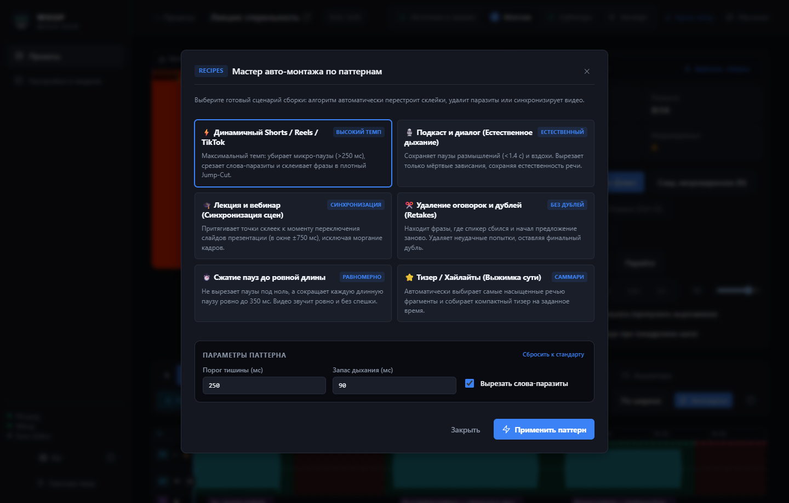

<p align="center">
  
</p>

<h1 align="center">WHISP MEDIA DESK</h1>

<p align="center">
  <b>Local AI-powered video editing and speech prep studio based on <a href="https://github.com/DmitryLeLeE/whisp">Whisp</a></b>
</p>

<p align="center">
  <a href="https://github.com/DmitryLeLeE/whisp_desk/releases"></a>
  
  
  
  <a href="https://github.com/DmitryLeLeE/whisp"></a>
  
  
  <a href="LICENSE"></a>
</p>

<p align="center">
  <a href="README.md">🇷🇺 Русский</a> • <b>🇬🇧 English</b>
</p>

---

A local desktop video editing studio for lectures, podcasts, webinars, and interviews powered by [Whisp](https://github.com/DmitryLeLeE/whisp).
Automatically detects silences and dead pauses, builds rough cuts, trims filler words, enables text-based video editing right from the transcript, automates editing with pattern recipes (Jump-Cuts, pause compression, duplicate takes removal), generates smart YouTube chapters, enhances voice clarity, and exports project files for Premiere Pro, DaVinci Resolve, and MP4. **100% local, runs offline, zero cloud API dependencies, zero data leakage**.

The server binds strictly to `127.0.0.1`. Original media files are never modified or duplicated — projects store a safe reference to the source.

---

### UI Screenshots

| Studio NLE Interactive Editor | Auto-Pattern Editing Studio |
|:---:|:---:|
|  |  |

| Subtitles, Text-Based Editing & Filler Words | Export (YouTube Chapters, NLE, Shorts 9:16) |
|:---:|:---:|
|  |  |

<details>
<summary><b>Expand additional screens (Projects, Setup & Analysis, Settings & Models)</b></summary>

| Projects List & Quick Start | Setup & Analysis Profiles |
|:---:|:---:|
|  |  |

| Whisp Local Speech Models Management |
|:---:|
|  |

</details>

---

## Key Features

* ⚡ **Auto-Pattern Editing Studio**: Pre-built assembly recipes applied with a single click:
  * *«Dynamic Shorts / Reels / TikTok (Jump-Cut)»* — High-cadence cut trimming micro-pauses and filler words.
  * *«Podcast & Dialogue (Natural Flow)»* — Preserves thoughtful pauses and soft inhalations.
  * *«Lecture with Slides (Scene Sync)»* — Snaps cuts directly to slide transition timestamps.
  * *«Retakes & Flub Removal»* — Automatically detects repeated attempts and false starts, keeping only the final clean take.
  * *«Pause Compression»* — Tightens long silences to a uniform 350 ms duration without jarring jumps.
  * *«Teaser & Highlights»* — Extracts high-density key segments for a 30s / 60s / 90s promo video.
* ✂️ **Automatic Rough Cuts**: Instant silence and speech detection via built-in FFmpeg analyzer or Auto-Editor with studio `V1` / `A1` track lanes.
* 📝 **Text-Based Video Editing (Descript-style)**: Edit video directly from the transcript — click the scissors `✂️` on any phrase to cut it from the timeline, or hit `↩️` to restore.
* 🧽 **1-Click Filler Word Cleaner**: Detects hesitations ("um", "uh", "like", "you know") and removes them from the timeline instantly.
* 📑 **Smart Chapters for YouTube**: Semantic video division with timestamps (`00:00 Intro`, `01:25 Core Concept`) ready to paste into video descriptions.
* 📱 **Vertical Auto-Reframe (9:16 Shorts/Reels)**: Rapid vertical video render with center-crop or blurred background padding.
* 🎙️ **Voice Enhancer & Noise Reduction**: Spectral denoiser (`afftdn`) and 4 studio EQ curves (*«Podcast»*, *«Clarity»*, *«Warmth»*, *«Broadcast Radio»*).
* 📸 **HD Frame / Thumbnail Grabber**: Save any frame in original 1080p/4K resolution straight from the timeline for YouTube thumbnails.
* 🧭 **Playhead Autoscroll**: Smooth tracking of the needle playhead across long recordings.
* 🎬 **Batch Import**: Drag and drop multiple videos simultaneously or select a batch in file explorer.
* 📦 **Zero-Re-encoding Export**: Export timeline projects to **Adobe Premiere Pro (XML)**, **DaVinci Resolve (FCPXML + Markers CSV)**, Final Cut Pro, EDL CMX3600, OpenTimelineIO, or render final MP4s with embedded subtitles.
* ⌨️ **Pro Keyboard Presets**: Support for **Adobe Premiere Pro** (`J-K-L`, `Q/W` Ripple Trim, `C` Razor, `M` Marker) and **DaVinci Resolve** workflows.
* 📌 **Timeline Markers**: Place markers via `M` shortcut, add custom labels, and export markers directly into DaVinci Resolve CSV.
* ⚡ **Quick Range Export**: Instantly render only selected `[In ... Out]` range into MP4 without rendering the entire timeline.
* 🔊 **EBU R128 Loudness Normalization**: Master audio volume to industry broadcast standards (-14 LUFS for YouTube/Shorts, -16 LUFS for podcasts, -23 LUFS for TV).
* 📖 **Custom Vocabulary & Names (Initial Prompt)**: Pass specialized terminology, brand names, and slang to eliminate Whisper hallucinations.
* 🔄 **GitHub Release Update Checker**: Check for new releases directly from Settings with 100% offline fallback.
* 📊 **Speech Insights**: Real-time Words Per Minute (WPM) calculation, runtime stats, trimmed duration, and content optimization ratio.

---

## Installation

### Windows Standalone Executable

Download the standalone `WHISP_MEDIA_DESK.exe` from [Releases](../../releases) and run it. The app opens in an integrated WebView2 window (preinstalled in Windows 10/11). FFmpeg, Auto-Editor 29.3.1, and Whisp are bundled inside — no additional dependencies required.

For desktop shortcuts and standard uninstallation, an installer `WHISP_MEDIA_DESK-setup.exe` is also available (installs into user profile, no admin rights required).

Projects, configurations, and logs are stored alongside the executable: `projects/`, `config/`, `logs/`. Place the exe in its own directory. Speech recognition models are downloaded once on first use (you can pre-download them in "Settings & Models").

Launch flags: `--browser` (open in default browser instead of window), `--no-window` (server-only mode), `--port 8765`.

### From Source

Requires Python 3.11+, Node.js 18+ (only for building frontend), and FFmpeg.

```bat
setup.bat      :: install dependencies and build frontend
run.bat        :: launch app window
```

### Self-Building Executable

```bat
build.bat                      :: bundles icon, UI, FFmpeg, Auto-Editor -> dist\WHISP_MEDIA_DESK.exe
iscc installer\whisp_desk.iss    :: create setup installer (requires Inno Setup 6)
```

The GitHub Release pipeline compiles Windows executables automatically upon pushing a `v*` tag (`.github/workflows/release.yml`).

### External Tools

Bundled inside the exe. When running from source, tools are discovered in `tools/<name>/`, then `config/settings.json`, then `PATH`. A local `tools/` directory adjacent to the exe takes priority.

| Tool | Purpose | Required |
|---|---|---|
| FFmpeg & FFprobe | Analysis and rendering. Requires build with libx264, libass, `loudnorm`, `alimiter` | Yes |
| [Auto-Editor](https://github.com/WyattBlue/auto-editor) 29.x | Secondary silence engine, alternative render, comparison | Optional |

### Embedded Whisp Engine

Speech recognition and subtitle translation are powered by [Whisp](https://github.com/DmitryLeLeE/whisp) 1.2.2 (faster-whisper), embedded in `backend/app/vendor/whisp`. Heavy ML inference runs in an isolated child process, keeping the UI responsive. Model size, source language, compute device, line length, and translation (NLLB-200) are configured under the "Subtitles" tab.

Hardware Acceleration: NVENC, QSV, and AMF encoder profiles are selectable in export settings. The application tests an encoding sample and falls back to libx264 if hardware encoding is unavailable.

---

## Workflow Guide

1. **Projects** → Create a new project.
2. **Setup & Analysis** → Select source video, configure analysis profile and engine, adjust thresholds if needed → Click "Run Analysis".
   Generates metadata, silence ranges, scene boundaries, waveform, proxy preview video, and rough cut plan.
3. **Editor** → Inspect decisions. Preview plays without re-rendering by skipping cut regions. Drag segment edges, select ranges on timeline. Use **«⚡ Patterns»** to apply Shorts, podcast, or lecture assembly recipes in 1 click.
4. **Subtitles** → Import existing SRT/VTT/ASS or transcribe via Whisp. Use text-based editing and 1-click filler word removal.
5. **Export** → Generate project files for NLE software (**Adobe Premiere Pro XML**, **DaVinci Resolve FCPXML**, CSV markers, OpenTimelineIO, EDL CMX3600), subtitles (SRT, VTT, ASS, bilingual), YouTube chapters, or render final MP4.

Editor Keyboard Shortcuts (Presets: **Whisp Desk**, **Adobe Premiere Pro**, **DaVinci Resolve**):

| Key | Action |
|---|---|
| `Space` | Play / Pause |
| `J` / `K` / `L` | Shuttle backward / Pause / Shuttle forward |
| `←` `→` | Step 1 frame backward / forward (Shift: 5 sec) |
| `Q` | Ripple Trim In (trim start of segment to playhead) |
| `W` | Ripple Trim Out (trim end of segment to playhead) |
| `S` / `C` / `B` | Split / Razor cut at playhead |
| `I` `O` | Set Range Mark In / Out |
| `K` / `C` | Keep / Cut selected segment (in Whisp Desk preset) |
| `R` | Mark decision as reviewed |
| `Enter` | Accept decision and jump to next unreviewed segment (with 1.5s preview buffer) |
| `N` | Jump to next unreviewed segment without accepting |
| `Ctrl+Z`, `Ctrl+Shift+Z` | Undo / Redo |
| `Ctrl` + Wheel | Zoom timeline at mouse cursor |
| `?` | Open shortcuts cheatsheet and layout preset selector |

---

## Analysis Engines

| | Built-in Engine | Auto-Editor |
|---|---|---|
| Silence Detection | FFmpeg `silencedetect` | `audio:threshold` Auto-Editor, read as `v1` chunks |
| Rendering | Single `filter_complex` graph, templates, intro/outro, watermark, subtitles, loudness normalization | `.v3` + `auto-editor`; without templates and burned subtitles |
| Recommendation | Default daily workflow | Specialized workflows or cross-checking cut points |

The "Compare Engines" button runs both engines with matching parameters and computes cut agreement percentage.

---

## Project Structure

```text
projects/lecture_001/
├── project.json
├── source/media_reference.json      # Safe pointer to original media
├── analysis/                        # metadata, silence, scenes, waveform, compare, proxy.mp4, thumbnails/
├── timeline/edit_plan.json          # Core timeline state
├── timeline/versions/, undo.json    # Snapshot versions and undo/redo stacks
├── subtitles/                       # original.srt, cues.json, edited.srt/.ass
├── exports/                         # final.mp4, preview.mp4, final.v3, final.fcpxml, final.edl
└── logs/processing.log
```

`edit_plan.json` (Schema v1) stores time in milliseconds; boundaries snap to source video frames upon rendering.
Segments include: `KEEP`/`CUT`, reason, `reviewed`, `locked` (protected from cuts), `manual`.

---

## How Silences Are Cut

Only the center of each silence gap is trimmed: safety padding before and after speech ensures dialogue never sounds clipped. Opening and closing silences are trimmed as `opening_trim` / `ending_trim`. Spurious micro-segments between cuts are removed. Videos consisting entirely of silence are never trimmed automatically.

| Profile | Noise Floor | Min Pause | Pre-Speech Pad | Post-Speech Pad |
|---|---:|---:|---:|---:|
| Careful | −40 dBFS | 2.0 s | 0.5 s | 0.6 s |
| Standard | −35 dBFS | 1.2 s | 0.35 s | 0.5 s |
| Aggressive | −32 dBFS (+ low-volume pass −26 dBFS from 3 s) | 0.7 s | 0.2 s | 0.3 s |

---

## Templates

Located in `templates/<name>/template.json` with accompanying graphics. Supports custom logo watermarks (`logo`: `file`, `position` `top-left|top-right|bottom-left|bottom-right`, `scale`, `margin`), intro/outro title cards (`intro` / `outro`: `image`, `duration_s`), subtitle styling, audio normalization, and encoder presets. Bundled presets: "Neutral", "Lecture", "Interview".

---

## Development

```bash
cd backend && pip install -r requirements-dev.txt && python -m pytest tests    # requires ffmpeg
cd backend && python -m app.main --no-window                                     # server mode, port 8765
cd frontend && npm install && npm run dev                                        # http://localhost:5173 with API proxy
python tools/make_icon.py                                                        # generate icon assets (requires Pillow)
python tools/make_screenshots.py                                                 # generate docs/ screenshots (requires playwright)
```

---

## Licenses

Project codebase is licensed under [MIT](LICENSE). Third-party components: FFmpeg — LGPL/GPL (bundled releases use GPL); Auto-Editor — Unlicense; PySceneDetect — BSD-3-Clause; FastAPI, React — MIT; SQLite — Public Domain. Whisper models have their own licenses; NLLB-200 weights (CC-BY-NC-4.0) are not bundled.
