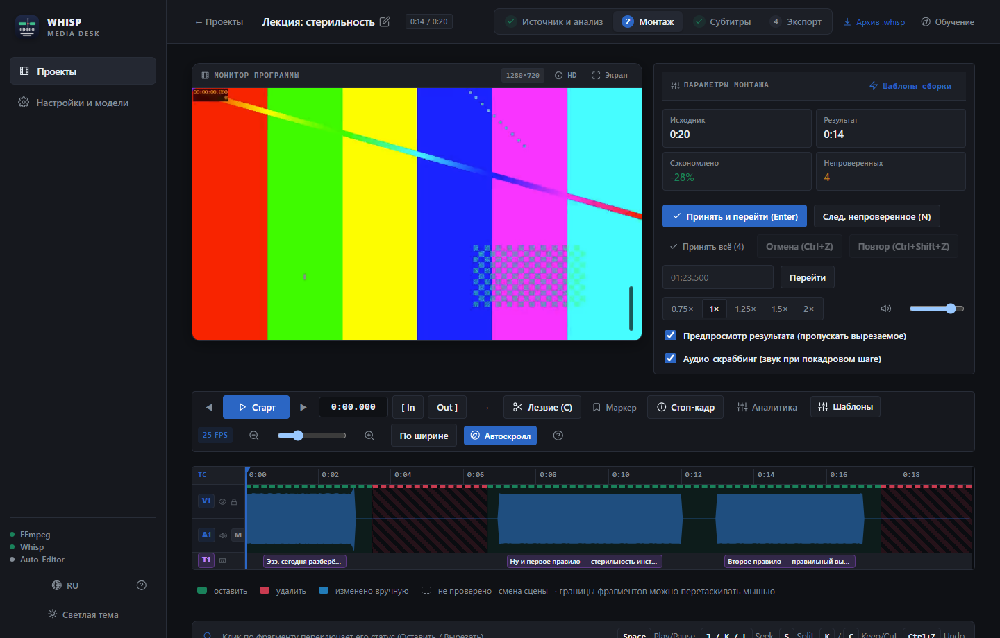
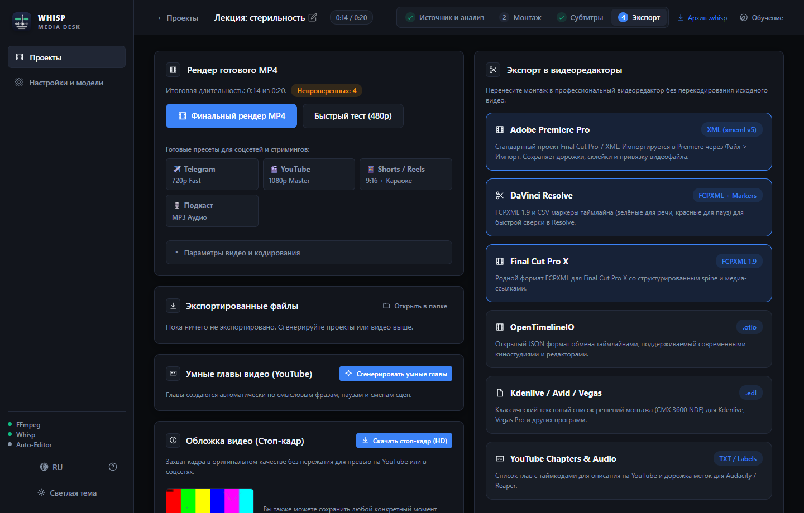

<p align="center">
  
</p>

<h1 align="center">WHISP MEDIA DESK</h1>

<p align="center">
  A rough-cut editor for talking-head video: finds and removes pauses, transcribes speech, makes subtitles<br>
  and renders the result. Everything runs on your computer.
</p>

<p align="center">
  <a href="https://github.com/DmitryLeLeE/whisp_desk/releases/latest"></a>
  
  <a href="LICENSE"></a>
</p>

<p align="center"><a href="README.md">Русский</a> · <b>English</b></p>



## What it is for

Lectures, interviews, podcasts, webinars, tutorials: you recorded a conversation full of pauses, filler words and retakes.
The app proposes what to cut, you review the decisions, and you get a video, subtitles and a project for Premiere Pro,
DaVinci Resolve or Final Cut Pro.

- No accounts, subscriptions or internet while working. Your video is never uploaded. Internet is needed only to download
  a speech model once (from 75 MB) and, optionally, to check for updates.
- A single file, `WHISP_MEDIA_DESK.exe`, with FFmpeg, Auto-Editor and [Whisp](https://github.com/DmitryLeLeE/whisp) inside.

## Getting started

1. Download `WHISP_MEDIA_DESK.exe` from [Releases](https://github.com/DmitryLeLeE/whisp_desk/releases/latest) and put it in
   its own folder: `projects/`, `config/` and `logs/` will appear next to it. There is also an installer,
   `WHISP_MEDIA_DESK-setup.exe`, if you want a Start menu shortcut.
2. Run it. The first start is slower than the rest because the exe unpacks itself (about 300 MB). Windows SmartScreen may warn
   about an unknown publisher because the file is not signed: "More info" → "Run anyway".
3. Drop a video into the window. The app asks how to process it: Auto (pauses and subtitles), Dynamic for Shorts, Gentle for interviews, Pauses only, or Manual. The chosen option runs by itself and opens the result in the editor. In manual mode, follow the four steps:

| Step | What you do |
|---|---|
| 1. Sources | Pick how aggressively to cut pauses (careful, standard, aggressive) and press "Recalculate". |
| 2. Rough cut | Review the proposed decisions: green stays, red is removed. Fix doubtful spots in the table or on the timeline. |
| 3. Subtitles | Transcribe with a Whisp model or import an SRT/VTT/ASS file. Translate, remove filler words. |
| 4. Export | Render an MP4 or export the cut for a video editor. Results are saved in the project folder. |

If the window does not open, run `WHISP_MEDIA_DESK.exe --browser` to use your browser instead.

## Features

| | |
|---|---|
| **Pause detection** | Built-in FFmpeg detector or Auto-Editor, three profiles, manual thresholds, noise reduction, scene change detection. |
| **Editing decisions** | Waveform timeline, split at playhead, reorder blocks, undo/redo, saved versions, markers. |
| **Assembly presets** | Dynamic (Shorts/Reels), podcast, lecture, retake removal, pause compression, 30/60/90 s teaser. |
| **Subtitles** | Whisp (faster-whisper) models from tiny to large-v3, language, custom vocabulary. NLLB-200 translation. Word highlight, styles, hardsub. Speaker labels. |
| **Audio** | Loudness normalisation (−14 / −16 / −23 LUFS), noise reduction, background music ducked under speech. |
| **Render** | FFmpeg MP4, 480p quick test, GPU encoders (NVENC, QSV, AMF) with CPU fallback, face-aware 9:16 reframe, stream copy at keyframes. |
| **Editor export** | Premiere (XML), DaVinci Resolve (FCPXML and marker CSV), Final Cut Pro (FCPXML), EDL, OpenTimelineIO, YouTube chapters. |
| **Publishing** | Show notes (YouTube, Telegram), cover frame, batch queue, portable `.whisp` project archives. |




## Verified and not verified

Verified automatically (101 backend tests, exe build and checks on Windows in GitHub Actions): pause detection, cut
calculation, rendering, subtitle retiming, export formats, exe start-up with bundled FFmpeg and Auto-Editor, and
transcription of synthesised speech with the tiny model from the exe itself.

Not verified on real hardware or software:

- the WebView2 window on a normal desktop (CI has no interactive session);
- opening exported files in Premiere Pro, DaVinci Resolve, Final Cut Pro and Kdenlive: the formats follow the
  specifications but were never opened in those applications;
- NVENC, QSV and AMF hardware encoding;
- NLLB-200 translation and GPU transcription;
- speaker labels come from a spectral heuristic without a neural network and can be wrong for similar voices.

Found a bug? "Settings and models" has a "Copy report for GitHub" button, attach it to an
[issue](https://github.com/DmitryLeLeE/whisp_desk/issues). The log is in `logs/desk.log` next to the exe.

## Run from source

Python 3.11+, Node.js 18+ and FFmpeg in `PATH` are required.

```bat
git clone https://github.com/DmitryLeLeE/whisp_desk.git
cd whisp_desk
setup.bat     :: dependencies and UI build
run.bat       :: start
```

Build the exe with `build.bat` (downloads FFmpeg and Auto-Editor, produces `dist\WHISP_MEDIA_DESK.exe`). Installer:
`iscc installer\whisp_desk.iss` (Inno Setup 6). Releases are built by GitHub Actions on a `v*` tag.

Flags: `--browser`, `--no-window`, `--port 8765`. External tools are looked up in `tools/<name>/` next to the exe, then in `PATH`.

## Licenses

The app is [MIT](LICENSE). The build includes Whisp 1.2.2 and faster-whisper (MIT), FFmpeg (GPL build), Auto-Editor (Unlicense),
FastAPI, React and other libraries. The NLLB-200 translation model is CC-BY-NC-4.0: non-commercial use only.
