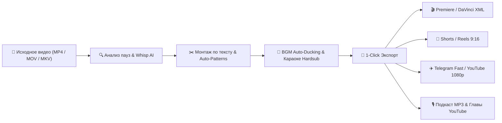

<p align="center">
  
</p>

<h1 align="center">WHISP MEDIA DESK</h1>

<p align="center">
  <b>Профессиональная локальная студия автоматического монтажа видео, обработки речи и генерации вирусных субтитров на основе <a href="https://github.com/DmitryLeLeE/whisp">Whisp</a></b>
</p>

<p align="center">
  <a href="https://github.com/DmitryLeLeE/whisp_desk/releases"></a>
  
  
  
  
  <a href="https://github.com/DmitryLeLeE/whisp"></a>
  
  
  <a href="LICENSE"></a>
</p>

<p align="center">
  <b>🇷🇺 Русский</b> • <a href="README.en.md">🇬🇧 English</a>
</p>

---

**WHISP MEDIA DESK** — это автономная настольная рабочая станция для контент-мейкеров, подкастеров, лекторов и видеомонтажёров. Программа автоматизирует черновой монтаж: мгновенно находит паузы и запинки, позволяет монтировать видео по тексту, чистит слова-паразиты, подкладывает фоновую музыку с авто-приглушением (Auto-Ducking), накладывает анимированные караоке-субтитры, генерирует таймкоды для YouTube и экспортирует проекты в Adobe Premiere Pro, DaVinci Resolve, Final Cut Pro и MP4/MP3.

> [!IMPORTANT]
> **100% приватность и автономность**: Никаких подписок, облачных серверов, скрытой телеметрии или ограничений по объёму видео. Вся нейросетевая обработка (Faster-Whisper) и рендеринг (FFmpeg) выполняются локально на вашем компьютере. Сервер изолирован на `127.0.0.1`.

---

## 🚀 Архитектура и рабочий процесс



---

## 📸 Интерфейс программы

| Интерактивный монтаж таймлайна (Audio Scrubbing) | Мастер авто-монтажа по паттернам |
|:---:|:---:|
|  |  |

| Текстовый монтаж и чистка слов-паразитов | Экспорт (Пресеты соцсетей, BGM, NLE, YouTube) |
|:---:|:---:|
|  |  |

<details>
<summary><b>Развернуть остальные экраны (Светлая тема, Проекты, Анализ, Модели)</b></summary>

| Тёмная студийная тема (Slate) | Светлая студийная тема (Canvas) |
|:---:|:---:|
|  |  |

| Монтаж в светлой теме (Высокий контраст) | Настройка и профили анализа |
|:---:|:---:|
|  |  |

| Управление локальными моделями Whisp |
|:---:|
|  |

</details>

---

## ⚡ Сравнение с облачными решениями

| Возможность | WHISP MEDIA DESK | Облачные редакторы (Descript, CapCut, Opus) |
|---|:---:|:---:|
| **Конфиденциальность** | 🛡️ **100% Оффлайн на вашем ПК** | ❌ Видео уходит на чужие серверы |
| **Оплата / Подписка** | 🆓 **Бесплатно, навсегда (MIT)** | ❌ Ежемесячная подписка ($20–$50/мес) |
| **Ограничения по длине** | ♾️ **Без ограничений (хоть 10 часов)** | ❌ Лимиты минут в месяц |
| **Экспорт таймлайна в NLE** | 🎬 **Premiere XML, DaVinci FCPXML, EDL, OTIO** | ⚠️ Урезано или требует платный тариф |
| **Фоновая музыка + Auto-Ducking** | 🎵 **Встроено (FFmpeg Sidechain)** | ⚠️ Базовое или ручное |
| **Караоке-субтитры по словам** | ✨ **Стили MrBeast, Neon, Minimal** | ⚠️ Базовые шаблоны с водяным знаком |
| **Портативные архивы проектов** | 📦 **.whisp bundles (<200 КБ)** | ❌ Привязка к проприетарному облаку |

---

## 🔥 Ключевой функционал

### 1. ⚡ Мастер сборки по паттернам (Auto-Pattern Studio)
Готовые интеллектуальные алгоритмы сборки чернового монтажа в 1 клик:

| Паттерн | Описание сценария | Идеально для |
|---|---|---|
| **Динамичный монтаж (Shorts / Reels)** | Jump-Cut монтаж с вырезкой микро-пауз и удалением паразитов | TikTok, Reels, Shorts |
| **Подкаст и диалог (Естественные паузы)** | Естественное дыхание, мягкие паузы (500 мс), отсутствие резких стыков | Подкасты, беседы |
| **Лекция со слайдами (Синхронизация)** | Привязка точек склеек к смене слайдов и презентаций | Вебинары, курсы |
| **Удаление повторных дублей (Retakes)** | Поиск оговорок и повторных попыток сказать фразу по транскрипту | Записи с дублями |
| **Сжатие длинных пауз** | Укорачивание затянутых пауз до комфортных 350 мс без спешки | Длинные доклады |
| **Тизер и хайлайты (Выжимка)** | Сборка динамичной выжимки ключевых фраз на 30, 60 или 90 секунд | Трейлеры, промо |

---

### 2. Фоновая музыка с умным авто-приглушением (BGM with Auto-Ducking)
* Бесшовное зацикливание любого аудио-трека (`-stream_loop -1`).
* **Sidechain Compression**: когда спикер начинает говорить, музыка мгновенно и плавно затухает на заданный уровень; в естественных паузах громкость музыки возвращается.
* Индивидуальный регулятор громкости и тумблер в настройках экспорта.

---

### 3. Караоке-субтитры с пословной подсветкой (Word-by-Word Active Highlight)
* Пословная анимация субтитров на основе временных меток Whisp.
* Текущее произносимое слово подсвечивается контрастным цветом (`{\c&H00EAFF&}`) и меняется в такт речи спикера.
* Пресеты оформления:
  * **Viral Shorts**: сверхжирный жёлтый шрифт Impact, мощная 5px обводка, объёмная тень.
  * **Cyber Neon**: бирюзовый текст с фиолетово-розовым неоновым свечением.
  * **Clean Minimal**: элегантный белый шрифт с мягкой подложкой.
* Выбор любого пользовательского цвета подсветки.

---

### 4. Пресеты для соцсетей и стримингов в 1 клик
* **Telegram Fast**: 720p, ультрабыстрый рендер, малый размер файла для быстрой отправки в чаты.
* **YouTube Master**: 1080p Full HD, -14 LUFS громкость, фильтр чёткости речи (Clarity Enhancer).
* **Shorts / Reels 9:16**: вертикальный кадр 1080x1920 (умный кроп по центру), караоке-субтитры.
* **Подкаст MP3**: экспорт только аудиодорожки (192 kbps), -16 LUFS, тёплый аналоговый тембр голоса.

---

### 5. Портативные архивы проектов (.whisp Project Bundles)
* Экспорт всего проекта со всеми маркерами, склейками, главами и субтитрами в компактный ZIP-файл `.whisp` (размером менее 200 КБ).
* Мгновенная передача проекта коллеге или на другой компьютер без пересылки гигабайтов исходного видео.
* Импорт в 1 клик через кнопку **«Импорт .whisp»** на главном экране.

---

### 6. Текстовый монтаж и чистка слов-паразитов
* Монтируйте видео прямо по тексту субтитров: клик по ножницам вырезает реплику из видеоряда, а повторный клик мгновенно возвращает её.
* Встроенный анализатор автоматически находит слова-паразиты (*«ну»*, *«короче»*, *«типа»*, *«как бы»*, *«эээ»*, *«ммм»*) и позволяет вырезать их пачкой.
* Поддержка пользовательского словаря терминов и редких имён (`initial_prompt`) для предотвращения галлюцинаций AI.

---

### 7. Студийный мастеринг звука и нормализация
* Автоматическая нормализация громкости по стандарту **EBU R128 (LUFS)**:
  * `-14 LUFS` — YouTube, Shorts, TikTok, Reels.
  * `-16 LUFS` — Подкасты, Spotify, Apple Podcasts.
  * `-23 LUFS` — Европейское телевидение и радиовещание.
* Спектральное шумоподавление (`afftdn`) для удаления гула кулеров, кондиционеров и шипения микрофона.
* Профили улучшения голоса: *«Подкаст»*, *«Чёткость речи (De-esser)»*, *«Теплота голоса»*, *«Студийное радио»*.
* Declick 8 мс: устранение микрощелчков на стыках склеек.

---

### 8. ⌨️ Горячие клавиши и навигация

Поддерживаются студийные раскладки **Adobe Premiere Pro**, **DaVinci Resolve** и **Whisp Desk**:

| Клавиша | Функция |
|:---:|---|
| <kbd>Пробел</kbd> | Воспроизведение / Пауза |
| <kbd>J</kbd> / <kbd>K</kbd> / <kbd>L</kbd> | Челночная перемотка назад / Пауза / Перемотка вперёд |
| <kbd>←</kbd> / <kbd>→</kbd> | Покадровый шаг с **аудио-скраббингом (Audio Scrubbing)** |
| <kbd>Q</kbd> / <kbd>W</kbd> | **Ripple Trim**: быстрая обрезка начала / конца фрагмента до курсора |
| <kbd>S</kbd> / <kbd>C</kbd> / <kbd>B</kbd> | Разрезать фрагмент по плейхеду (Razor / Blade) |
| <kbd>I</kbd> / <kbd>O</kbd> | Установить точку входа / выхода диапазона (In / Out) |
| <kbd>M</kbd> | Поставить цветной маркер с заметкой на таймлайне |
| <kbd>~</kbd> / <kbd>F11</kbd> | Развернуть видеомонитор на весь экран |
| <kbd>R</kbd> | Отметить фрагмент проверенным |
| <kbd>Enter</kbd> | Принять решение и перейти к следующему фрагменту |
| <kbd>Ctrl + Z</kbd> / <kbd>Ctrl + Shift + Z</kbd> | Отмена / Повтор действия (Undo / Redo) |
| <kbd>?</kbd> | Открыть интерактивную шпаргалку по клавишам |

---

### 9. 🎬 Совместимость с монтажными программами (NLE)

| Программа | Формат экспорта | Что сохраняется |
|---|:---:|---|
| **Adobe Premiere Pro** | `Final Cut Pro 7 XML (xmeml v5)` | Дорожки V1/A1, точки склеек, таймкод, привязка к исходнику |
| **DaVinci Resolve** | `FCPXML 1.9 + Markers CSV` | Таймлайн со склейками, цветные маркеры речи и пауз |
| **Apple Final Cut Pro** | `FCPXML 1.9` | Нативный FCPXML проект со структурированным spine |
| **Kdenlive / Avid / Vegas** | `CMX 3600 EDL` | Текстовый список монтажных решений |
| **Современные пайплайны** | `OpenTimelineIO (.otio)` | Открытый отраслевой стандарт киностудий |
| **YouTube** | `Smart Chapters (.txt)` | Готовое текстовое оглавление для описания ролика |

---

## 📥 Установка и запуск

### Вариант 1: Готовый бинарный релиз для Windows (Рекомендуется)

1. Перейдите в раздел [Releases](../../releases) и скачайте `WHISP_MEDIA_DESK.exe` (или инсталлятор `WHISP_MEDIA_DESK-setup.exe`).
2. Положите exe в удобную папку (все проекты и настройки будут храниться рядом в `projects/` и `config/`).
3. Запустите файл. Откроется окно программы (на базе системного WebView2).
4. Все зависимости (FFmpeg, Auto-Editor, Whisp) уже упакованы внутри — дополнительно ничего устанавливать не нужно!

> [!NOTE]
> **Предупреждение Windows SmartScreen при первом запуске**:
> Так как программа является независимым бесплатным open-source проектом без коммерческого платного сертификата Microsoft, фильтр SmartScreen может показать синее окно («Система Windows защитила ваш компьютер»).
> Чтобы продолжить: нажмите **«Подробнее» (More info)** ➔ **«Выполнить в любом случае» (Run anyway)**.

---

### Вариант 2: Запуск из исходного кода

Требуются: **Python 3.11+**, **Node.js 18+** и **FFmpeg** в `PATH`.

```bash
# Клонирование репозитория
git clone https://github.com/DmitryLeLeE/whisp_desk.git
cd whisp_desk

# Установка зависимостей и сборка интерфейса
setup.bat

# Запуск приложения
run.bat
```

---

## 🛠️ Разработка и тестирование

```bash
# Запуск тестов бэкенда (89 тестов)
cd backend && pytest tests

# Запуск сервера разработки бэкенда
python -m app.main --no-window

# Запуск dev-сервера фронтенда (с hot-reload)
cd frontend && npm run dev
```

---

## 📄 Лицензия

Проект распространяется под открытой лицензией [MIT](LICENSE).

Сторонние компоненты:
* **Whisp** (faster-whisper) — MIT License.
* **FFmpeg** — LGPL / GPL License.
* **Auto-Editor** — Unlicense.
* **React / FastAPI** — MIT License.

---

<p align="center">
  Разработано с душой для эффективного создания контента. ⭐ Поставьте звезду проекту на GitHub!
</p>
