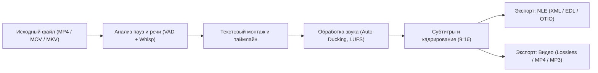
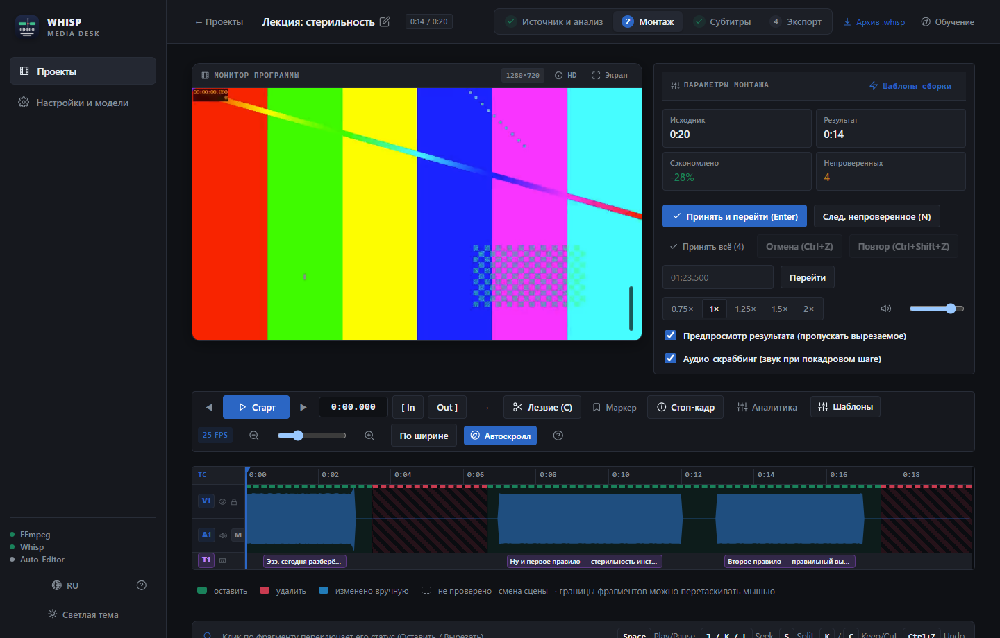
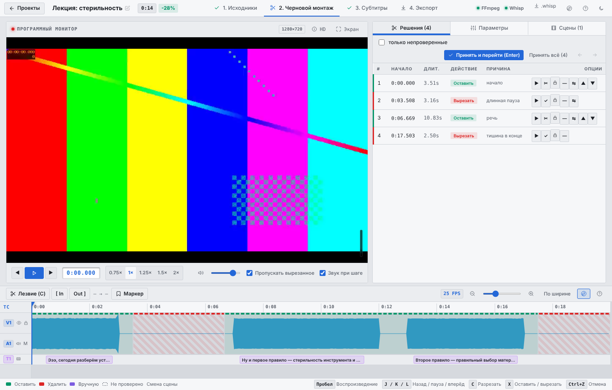

<p align="center">
  
</p>

<h1 align="center">WHISP MEDIA DESK</h1>

<p align="center">
  Автономное настольное приложение для локального монтажа видео по речи, автоматической вырезки пауз и генерации синхронизированных субтитров на базе <a href="https://github.com/DmitryLeLeE/whisp">Whisp</a>.
</p>

<p align="center">
  <a href="https://github.com/DmitryLeLeE/whisp_desk/releases"></a>
  
  
  
  
  <a href="https://github.com/DmitryLeLeE/whisp"></a>
  
  
  <a href="LICENSE"></a>
</p>

<p align="center">
  <b>Русский</b> • <a href="README.en.md">English</a>
</p>

---

**Whisp Media Desk** — рабочая станция для автоматизации чернового видеомонтажа, подкастов, интервью и обучающих видео. Программа анализирует аудиодорожку с помощью локальных моделей Faster-Whisper и алгоритмов детекции голосовой активности (VAD), находит паузы и запинки, позволяет монтировать видеоряд через правку текста, удаляет слова-паразиты, сводит фоновую музыку через sidechain-компрессию, генерирует пословные субтитры и экспортирует результат в видеоредакторы (Adobe Premiere Pro, DaVinci Resolve, Final Cut Pro) либо напрямую в готовые медиафайлы через FFmpeg.

> [!NOTE]
> **Автономность и безопасность данных**: приложение не требует регистрации, подписок и доступа к внешним облачным сервисам. Вся обработка аудио, транскрипция и видеорендеринг выполняются исключительно на локальном компьютере. Встроенный сервер изолирован на адресе `127.0.0.1`.

---

## Архитектура и пайплайн обработки



---

## Интерфейс

| Интерактивный таймлайн и аудио-скраббинг | Пресеты авто-монтажа по паттернам |
|:---:|:---:|
|  |  |

| Текстовый монтаж и диаризация | Панель экспорта и сведение звука |
|:---:|:---:|
|  |  |

<details>
<summary>Дополнительные экраны (светлая тема, список проектов, настройки моделей)</summary>

| Темная студийная тема | Светлая контрастная тема |
|:---:|:---:|
|  |  |

| Монтаж в светлой теме | Параметры детекции речи |
|:---:|:---:|
|  |  |

| Управление локальными моделями нейросети |
|:---:|
|  |

</details>

---

## Сравнение с альтернативными решениями

| Параметр | Whisp Media Desk | Облачные редакторы (Descript, CapCut, Opus) |
|---|---|---|
| Обработка данных | Локально на компьютере (без передачи во внешнюю сеть) | Передача медиафайлов на сторонние серверы |
| Модель оплаты | Бесплатно, открытый исходный код (лицензия MIT) | Ежемесячная подписка ($20–$50/мес) |
| Ограничения по длительности | Без ограничений по объему и хронометражу | Лимиты минут в тарифных планах |
| Экспорт в монтажные программы (NLE) | Premiere XML, DaVinci FCPXML, EDL, OTIO | Ограничено либо требует платного тарифа |
| Нарезка без перекодирования | Поддерживается (Lossless Cut, `-c copy`) | Не поддерживается (только полный рендеринг) |
| Фоновая музыка с авто-приглушением | Встроенный Sidechain компрессор FFmpeg | Базовое микширование или ручная правка |
| Синхронизированные субтитры | ASS / SRT / VTT с пословной анимацией | Шаблоны с водяными знаками на базовых планах |
| Формат хранения проектов | Автономные архивы `.whisp` (< 200 КБ) | Привязка к закрытой облачной платформе |

---

## Основные возможности

### 1. Автоматический черновой монтаж
* Анализ голосовой активности (Silero VAD и пороговый энергетический фильтр).
* Точное обнаружение пауз между словами и предложениями с миллисекундной точностью.
* Готовые сценарии сборки:
  * **Динамичный монтаж (Shorts / Reels)** — вырезка пауз длиннее 250 мс для создания быстрого темпа.
  * **Подкаст и диалог** — сохранение естественного дыхания с ограничением пауз до 500 мс.
  * **Лекция и вебинар** — синхронизация склеек с логическими блоками изложения.
  * **Удаление дублей (Retakes)** — распознавание повторных попыток произнесения фраз.
  * **Сжатие пауз** — пропорциональное сокращение затянутых пауз до целевой длительности (300–400 мс).
  * **Тизер и выжимка** — сборка дайджеста ключевых тезисов на 30, 60 или 90 секунд.

### 2. Мгновенный Lossless-экспорт (Stream Copy)
* Экспорт видео и аудиопотоков без перекодирования (`-c copy`) за 2–4 секунды.
* Склейка через FFmpeg concat demuxer по ключевым кадрам (I-frames) без потери качества исходника.
* Режим активируется отдельным переключателем в панели экспорта.

### 3. Текстовый монтаж и очистка речи
* Монтаж видеоряда по тексту транскрипции: клик по фразе или слову исключает его из финального монтажа либо возвращает обратно.
* Автоматический поиск слов-паразитов (*«ну»*, *«короче»*, *«типа»*, *«как бы»*, *«эээ»*, *«ммм»*) с возможностью пакетного удаления.
* Поддержка пользовательского словаря терминов и имен собственных (`initial_prompt`) для предотвращения ошибок распознавания.

### 4. Диаризация спикеров
* Локальный анализ спектральных параметров речевого сигнала (основной тон F0, спектральный центроид, спад энергии, форманты).
* Автоматическая кластеризация сегментов по спикерам (KMeans) с индикацией надежности разделения.
* Отображение цветовых меток участников в панели субтитров и переключение спикера в один клик.

### 5. Инструмент «Лезвие» и перестановка блоков (Storyboarding)
* Быстрое разделение активного сегмента по положению курсора воспроизведения клавишами <kbd>C</kbd> или <kbd>B</kbd>.
* Изменение порядка следования смысловых блоков кнопками <kbd>▲</kbd> и <kbd>▼</kbd> в таблице решений с автоматическим сохранением последовательности при рендеринге.

### 6. Синхронизированные субтитры с пословным выделением
* Формирование субтитров с точностью до отдельных слов на базе таймкодов Whisp.
* Анимация активного произносимого слова в такт речи с подсветкой акцентным цветом.
* Настраиваемые стили:
  * **Контрастный (Shorts / Reels)** — плотный шрифт, утолщенная обводка и контрастная тень.
  * **Неоновый акцент** — цветной текст со свечением.
  * **Минималистичный** — аккуратный светлый шрифт с полупрозрачной подложкой.
* Экспорт в форматах ASS (со стилями), SRT, VTT и встроенный hardsub в видео.

### 7. Фоновая музыка с авто-приглушением (Auto-Ducking)
* Зацикливание выбранного аудиофайла на всю длительность видео (`-stream_loop -1`).
* Аппаратный Sidechain-компрессор через FFmpeg: автоматическое плавное снижение громкости музыки во время речи и восстановление уровня в паузах.
* Регулировка глубины приглушения и баланса уровней.

### 8. Умное кадрирование под 9:16 (Smart Face Reframe)
* Автоматическое распознавание лица в кадре с использованием OpenCV.
* Расчет сглаженной траектории центрирования для перевода горизонтального видео (16:9) в вертикальный формат (9:16) под мобильные платформы.

### 9. Пакетная очередь обработки (Batch Queue)
* Добавление группы видеофайлов для последовательной автоматической обработки.
* Выбор профиля обработки и фоновое выполнение задач в пуле воркеров с индикацией прогресса.

### 10. Генератор шоу-ноутов и метаданных
* Автоматическое формирование сопроводительных текстовых материалов по транскрипту:
  * **YouTube**: описание с кликабельными таймкодами глав.
  * **Telegram**: форматированный пост с тезисами и ключевыми выводами выпуска.
* Копирование готового текста в буфер обмена в один клик.

### 11. Нормализация и мастеринг аудио
* Приведение громкости к отраслевым стандартам **EBU R128 (LUFS)**:
  * `-14 LUFS` — YouTube, Shorts, TikTok, Reels.
  * `-16 LUFS` — Подкасты, Spotify, Apple Podcasts.
  * `-23 LUFS` — Вещательные стандарты.
* Спектральное шумоподавление (`afftdn`) для устранения фонового гула и шумов тракта записи.
* Встроенный декликер (8 мс) для предотвращения щелчков на стыках аудиофрагментов.

### 12. Портативные архивы проектов (.whisp)
* Экспорт разметки, маркеров, субтитров и настроек проекта в компактный ZIP-файл `.whisp` (менее 200 КБ).
* Быстрый перенос проекта между рабочими станциями без необходимости дублирования исходных медиафайлов.

---

## Экспорт в монтажные программы (NLE)

| Программа | Формат файла | Содержимое |
|---|---|---|
| Adobe Premiere Pro | Final Cut Pro 7 XML (`xmeml v5`) | Видео- и аудиодорожки, склейки, таймкод, привязка к медиа |
| DaVinci Resolve | FCPXML 1.9 + Markers CSV | Таймлайн со склейками, цветовая разметка речи и пауз |
| Apple Final Cut Pro | FCPXML 1.9 | Нативный проект со структурированным spine |
| Kdenlive / Avid / Vegas | CMX 3600 EDL | Стандартный список монтажных решений |
| Студийные пайплайны | OpenTimelineIO (`.otio`) | Открытый стандарт обмена данными таймлайна |
| YouTube | Главы (`.txt`) | Текстовый список временных меток для описания |

---

## Горячие клавиши

| Сочетание клавиш | Действие |
|---|---|
| <kbd>Пробел</kbd> | Воспроизведение / Пауза |
| <kbd>J</kbd> / <kbd>K</kbd> / <kbd>L</kbd> | Перемотка назад / Пауза / Перемотка вперед |
| <kbd>←</kbd> / <kbd>→</kbd> | Покадровый шаг с аудио-скраббингом |
| <kbd>Q</kbd> / <kbd>W</kbd> | Обрезка начала / конца фрагмента до положения курсора (Ripple Trim) |
| <kbd>S</kbd> / <kbd>C</kbd> / <kbd>B</kbd> | Разрезать сегмент по курсору (Razor Cut) |
| <kbd>I</kbd> / <kbd>O</kbd> | Установить точку входа / выхода диапазона |
| <kbd>M</kbd> | Добавить маркер с комментарием на таймлайне |
| <kbd>~</kbd> / <kbd>F11</kbd> | Полноэкранный режим видеоплеера |
| <kbd>R</kbd> | Отметить фрагмент проверенным |
| <kbd>Enter</kbd> | Подтвердить решение и перейти к следующему фрагменту |
| <kbd>Ctrl</kbd> + <kbd>Z</kbd> | Отменить последнее действие (Undo) |
| <kbd>Ctrl</kbd> + <kbd>Shift</kbd> + <kbd>Z</kbd> | Повторить отмененное действие (Redo) |
| <kbd>?</kbd> | Показать панель горячих клавиш |

---

## Установка и запуск

### Вариант 1. Готовый исполняемый файл для Windows (Рекомендуется)

1. Перейдите на страницу [Releases](../../releases) и загрузите архив или установщик `WHISP_MEDIA_DESK.exe`.
2. Распакуйте приложение в выбранную директорию (файлы проектов и настройки сохраняются локально в подпапках `projects/` и `config/`).
3. Запустите исполняемый файл. Приложение откроется в нативном окне WebView2.
4. Все компоненты (FFmpeg, модели речи) работают автономно и не требуют сторонней установки.

> [!NOTE]
> **Предупреждение Windows SmartScreen**:
> Так как программа является независимым проектом с открытым исходным кодом без платного сертификата подписи кода Microsoft, фильтр SmartScreen может запросить подтверждение при первом запуске. Для продолжения нажмите **«Подробнее» (More info)** ➔ **«Выполнить в любом случае» (Run anyway)**.

---

### Вариант 2. Запуск из исходного кода

Требования: **Python 3.11+**, **Node.js 18+**, **FFmpeg** в системном `PATH`.

```bash
# Клонирование репозитория
git clone https://github.com/DmitryLeLeE/whisp_desk.git
cd whisp_desk

# Установка зависимостей и сборка интерфейса
setup.bat

# Запуск приложения
run.bat
```

---

## Разработка и тестирование

```bash
# Запуск автоматических тестов бэкенда (98 тестов)
cd backend && pytest tests

# Запуск бэкенда в режиме разработки
python -m app.main --no-window

# Запуск dev-сервера фронтенда
cd frontend && npm run dev
```

---

## Лицензия

Проект распространяется под открытой лицензией [MIT](LICENSE).

Используемые открытые библиотеки:
* **Whisp** (faster-whisper) — MIT License.
* **FFmpeg** — LGPL / GPL License.
* **Auto-Editor** — Unlicense.
* **FastAPI** — MIT License.
* **React** — MIT License.
