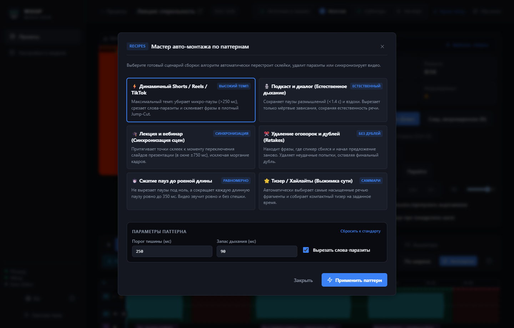
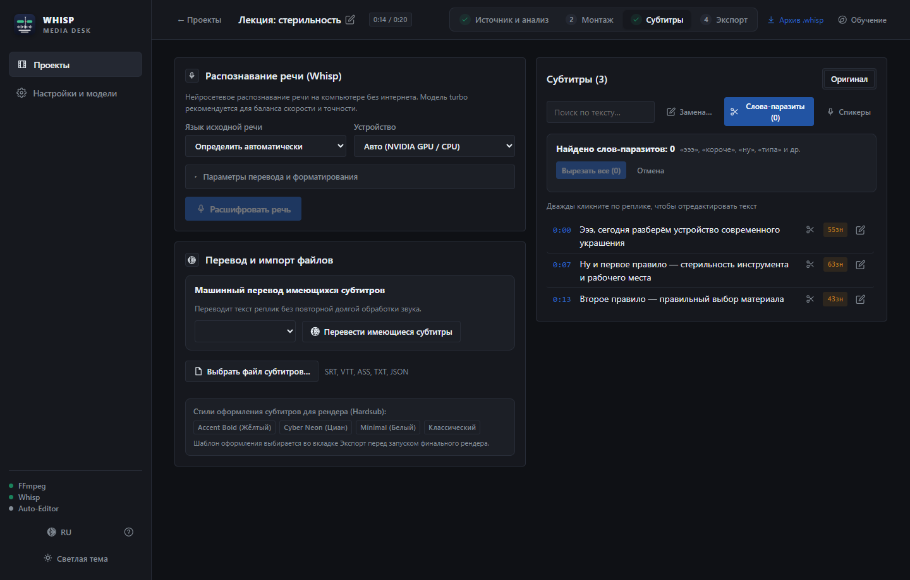
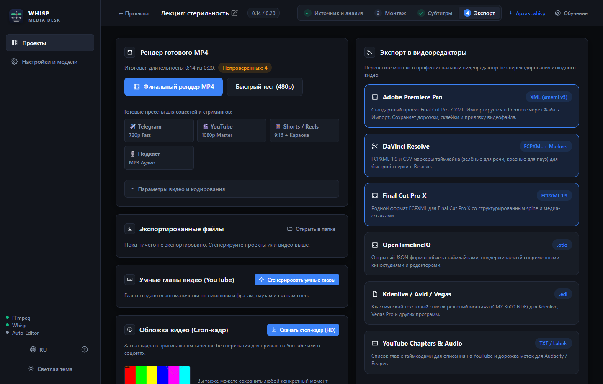
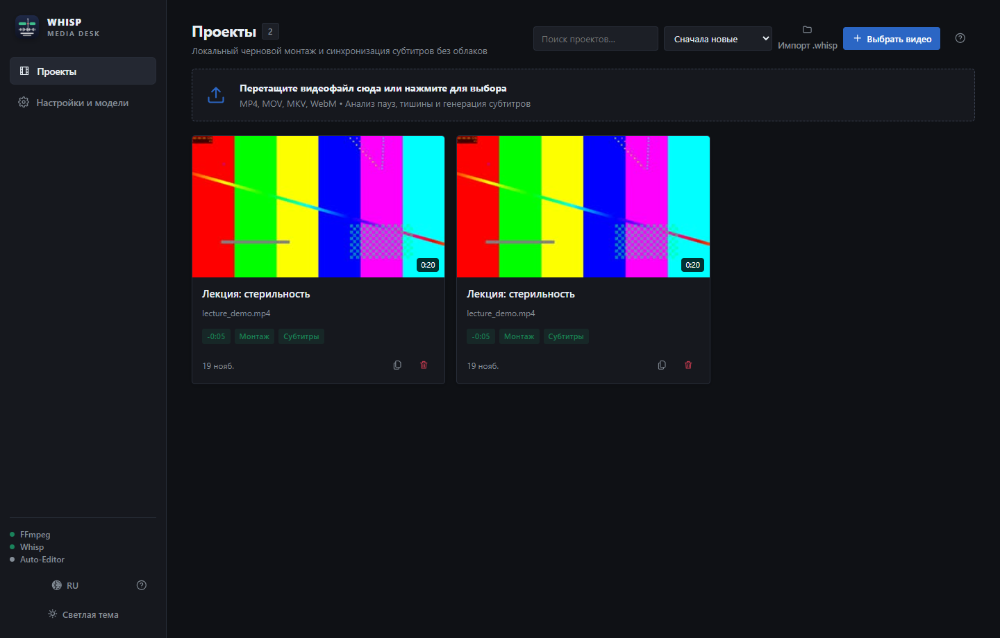
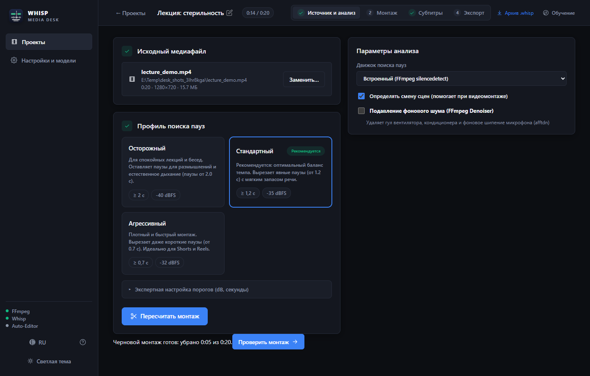
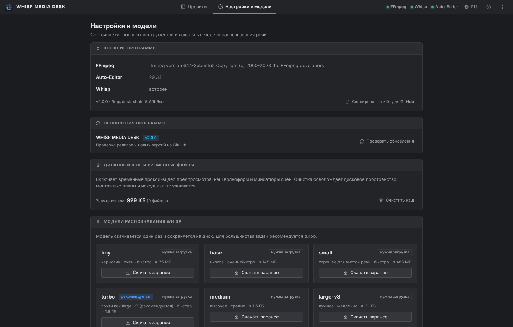

<p align="center">
  
</p>

<h1 align="center">WHISP MEDIA DESK</h1>

<p align="center">
  <b>Локальная студия автоматического монтажа видео и обработки речи на основе <a href="https://github.com/DmitryLeLeE/whisp">Whisp</a></b>
</p>

<p align="center">
  <a href="https://github.com/DmitryLeLeE/whisp_desk/releases"></a>
  
  
  
  <a href="https://github.com/DmitryLeLeE/whisp"></a>
  
  
  <a href="LICENSE"></a>
</p>

<p align="center">
  <b>🇷🇺 Русский</b> • <a href="README.en.md">🇬🇧 English</a>
</p>

---

Локальная студия подготовки видео (лекции, подкасты, интервью, вебинары) на основе [Whisp](https://github.com/DmitryLeLeE/whisp).
Находит паузы, строит черновой монтаж, вырезает слова-паразиты, даёт монтировать видео прямо по тексту, собирает видео по готовым паттернам (Jump-Cut, сжатие пауз, удаление дублей), генерирует главы для YouTube, улучшает голос и экспортирует проект в Premiere Pro, DaVinci Resolve и MP4. Всё работает на вашем компьютере: **100% локально, без интернета, без облачных API и без передачи данных**.

Сервер слушает только `127.0.0.1`. Исходные файлы не изменяются и не копируются — проект хранит безопасную ссылку на оригинал.

---

### Скриншоты интерфейса

| Интерактивный монтаж студийного уровня | Мастер авто-монтажа по паттернам |
|:---:|:---:|
|  |  |

| Субтитры, текстовый монтаж и чистка паразитов | Экспорт (YouTube Chapters, NLE, Shorts 9:16) |
|:---:|:---:|
|  |  |

<details>
<summary><b>Развернуть остальные экраны (Проекты, Настройка анализа, Настройки и модели)</b></summary>

| Список проектов и быстрый старт | Настройка и профили анализа |
|:---:|:---:|
|  |  |

| Управление локальными моделями Whisp |
|:---:|
|  |

</details>

---

## Ключевые возможности

* ⚡ **Мастер авто-монтажа по паттернам (Auto-Pattern Studio)**: Готовые сценарии сборки в один клик:
  * *«Динамичный Shorts / Reels (Jump-Cut)»* — плотная подача с вырезкой микро-пауз и слов-паразитов.
  * *«Подкаст и диалог (Естественное дыхание)»* — сохранение смысловых пауз и мягких вдохов.
  * *«Лекция со слайдами (Синхронизация сцен)»* — привязка точек склеек к переключению слайдов презентации.
  * *«Удаление дублей и оговорок (Retakes)»* — нахождение повторных дублей речи по субтитрам и удаление неудачных попыток.
  * *«Сжатие пауз до ровной длины»* — сокращение длинных пауз до комфортных 350 мс без спешки.
  * *«Тизер / Хайлайты»* — выжимка самых ёмких фраз на 30/60/90 секунд.
* ✂️ **Автоматический черновой монтаж**: Мгновенный поиск пауз и тишины через встроенный анализатор или Auto-Editor со студийными дорожками `V1` / `A1`.
* 📝 **Текстовый монтаж (как в Descript)**: Монтируйте видео прямо по расшифровке — кликните по ножницам `✂️` в реплике, чтобы вырезать её из видеоряда, или верните обратно `↩️`.
* 🧽 **Чистка слов-паразитов в 1 клик**: Детектор запинок («эээ», «ммм») и слов-паразитов («ну», «короче», «типа», «как бы») с мгновенным удалением на таймлайне.
* 📑 **Умные главы для YouTube (Smart Chapters)**: Семантическая разбивка видео на главы с таймкодами (`00:00 Введение`, `01:25 Основная тема`) и копированием для описания ролика в один клик.
* 📱 **Авто-кадрирование под Shorts / Reels / TikTok (9:16)**: Быстрый рендер вертикальных роликов с центрированием кадра или размытием полей.
* 🎙️ **Улучшение голоса и шумоподавление**: Спектральный денойзер (`afftdn`) и студийные профили эквализации голоса (*«Подкаст»*, *«Чёткость речи»*, *«Теплота»*, *«Радио»*).
* 📸 **Захват стоп-кадров (HD Thumbnail Grabber)**: Сохранение любого кадра в оригинальном разрешении 1080p/4K прямо из таймлайна для создания обложки видео.
* 🧭 **Автоскролл за плейхедом**: Плавное слежение экрана за курсором воспроизведения на длинных записях.
* 🎬 **Пакетный импорт**: Перетаскивайте несколько файлов одновременно или выбирайте пачкой в проводнике.
* 📦 **Экспорт без перекодирования**: Форматы **Adobe Premiere Pro (XML)**, **DaVinci Resolve (FCPXML + Markers CSV)**, Final Cut Pro, EDL CMX3600, OpenTimelineIO и готовый MP4 со вшитыми субтитрами.
* ⌨️ **Профили горячих клавиш**: Поддержка раскладок **Adobe Premiere Pro** (`J-K-L`, `Q/W` Ripple Trim, `C` Razor, `M` Marker, `~` Fullscreen) и **DaVinci Resolve**.
* 🎧 **Аудио-скраббинг (Audio Scrubbing)**: Прослушивание ультракороткого звукового среза при покадровом шаге стрелками (<kbd>←</kbd> / <kbd>→</kbd>) для сверхточного поиска начала слов.
* 🖥️ **Полноэкранный монитор (Fullscreen View)**: Разворот монитора программы на весь экран по горячей клавише <kbd>~</kbd> / <kbd>F11</kbd> или кнопке в заголовке панели.
* 💬 **Дорожка субтитров T1 на таймлайне**: Визуальные плашки реплик прямо под аудиоволной с быстрым переходом к реплике по клику.
* 🔥 **Шаблоны оформления субтитров для Shorts/Reels**: Стили *«🔥 MrBeast Viral»* (жирный жёлтый шрифт с 3D-тенью), *«⚡ Cyber Neon»* и *«✨ Clean Minimal»*.
* 📂 **Поиск, сортировка и дублирование проектов**: Мгновенный поиск по проектам, гибкая сортировка и создание копий проекта в 1 клик для тестирования вариантов монтажа.
* 🧹 **Очистка дискового кэша (Cache Cleaner)**: Подсчёт занятого дискового пространства и удаление временных прокси и миниатюр прямо из настроек.
* 📌 **Маркеры на таймлайне (Timeline Markers)**: Добавление меток по клавише `M`, интерактивные пины, заметки и экспорт маркеров в DaVinci Resolve CSV.
* ⚡ **Быстрый экспорт диапазона (Range Export)**: Рендеринг выделенного отрезка `[In ... Out]` в отдельный MP4 без рендера всего видео.
* 🔊 **Мастеринг громкости EBU R128 (Loudness Normalization)**: Авто-нормализация звука под стандарты стримингов (-14 LUFS для YouTube/Shorts, -16 LUFS для подкастов, -23 LUFS для ТВ).
* 📖 **Словарь терминов и имён (Initial Prompt)**: Точное распознавание редких брендов, англицизмов и имён собственных без галлюцинаций.
* 🔄 **Проверка обновлений (Update Checker)**: Проверка релизов на GitHub из раздела «Настройки» с поддержкой 100% оффлайн-работы.
* 📊 **Аналитика речи (Speech Insights)**: Подсчёт скорости речи (WPM), хронометража, сэкономленного времени и индекса оптимизации контента.

---

## Установка

### Готовая сборка для Windows

Скачайте со страницы [Releases](../../releases) один файл `WHISP_MEDIA_DESK.exe` и запустите его. Откроется окно
программы (на WebView2, он есть в Windows 10/11). Внутри уже лежат FFmpeg (GPL-сборка), Auto-Editor 29.3.1 и Whisp,
ничего ставить не нужно. Первый запуск медленнее остальных: exe распаковывает себя во временную папку.

Для ярлыков и удаления через «Программы и компоненты» есть установщик `WHISP_MEDIA_DESK-setup.exe` (ставит в профиль
пользователя, права администратора не нужны). Архив `WHISP_MEDIA_DESK-windows.zip` содержит тот же exe с README.

Проекты, настройки и журналы лежат рядом с exe: `projects/`, `config/`, `logs/`. Положите exe в отдельную папку.
Модели распознавания речи скачиваются один раз при первом использовании (в «Настройки и модели» их можно скачать заранее
и выбрать папку для них).

Если Windows SmartScreen предупреждает о неизвестном издателе — exe не подписан.

Параметры запуска: `--browser` (открыть в браузере вместо окна), `--no-window` (только сервер), `--port 8765`.
Если окно не открылось, программа сама откроет браузер.

### Из исходников

Нужны Python 3.11+, Node.js 18+ (только чтобы собрать интерфейс) и FFmpeg.

```bat
setup.bat      :: зависимости и сборка интерфейса
run.bat        :: запуск, откроется окно
```

### Сборка exe самостоятельно

```bat
build.bat      :: зависимости, иконка, интерфейс, FFmpeg и Auto-Editor, PyInstaller -> dist\WHISP_MEDIA_DESK.exe
iscc installer\whisp_desk.iss    :: установщик (нужен Inno Setup 6), необязательно
```

Это один файл без папки рядом. Релиз на GitHub собирается автоматически при теге `v*` (`.github/workflows/release.yml`).

### Внешние программы

В exe они уже есть. При запуске из исходников и для подмены версии ищутся в `tools/<имя>/`, затем в `config/settings.json`,
затем в `PATH`. Положенная рядом с exe папка `tools/` имеет приоритет над встроенной копией.

| Программа | Зачем | Обязательна |
|---|---|---|
| FFmpeg и FFprobe | анализ, рендер. Нужна сборка с libx264, libass, `loudnorm`, `alimiter` | да |
| [Auto-Editor](https://github.com/WyattBlue/auto-editor) 29.x | второй движок поиска пауз, альтернативный рендер, сравнение | нет |

### Whisp встроен

Распознавание речи и перевод субтитров — это [Whisp](https://github.com/DmitryLeLeE/whisp) 1.2.2 (faster-whisper),
скопированный в `backend/app/vendor/whisp` без изменений (см. `VENDORED.md`). Тяжёлую работу делает дочерний процесс
того же exe, поэтому окно не зависает, а отмена задачи убивает процесс. Выбор модели, языка, устройства, длины строки,
перевод на другой язык (NLLB-200) — на вкладке «Субтитры». Папка моделей настраивается в «Настройки и модели».

Если нужна своя копия Whisp (например, другая версия), укажите её: переменная `WHISP_DIR` или `whisp_dir` в
`config/settings.json`. Она используется только когда встроенный движок недоступен.

Видеокарта: в параметрах сборки можно выбрать NVENC, QSV или AMF. Приложение кодирует пробный кадр и при неудаче, в том числе
посреди рендера, возвращается к libx264. На реальном железе эти энкодеры не проверялись.

---

## Как работать

1. **Проекты** → создать проект.
2. **Источник и анализ** → указать видео, выбрать профиль и движок, при необходимости поправить пороги → «Запустить анализ».
   Создаются метаданные, список пауз, смена сцен, аудиоволна, лёгкая копия для предпросмотра и черновой план.
3. **Монтаж** → проверить решения. Предпросмотр идёт без рендера: вырезаемое пропускается. Границы фрагментов
   перетаскиваются, интервал выделяется протяжкой по шкале. Кнопка **«⚡ Паттерны сборки»** позволяет применить авто-монтаж под Shorts, подкаст или лекцию в 1 клик.
4. **Субтитры** → импорт SRT/VTT/ASS/TXT/JSON или расшифровка через Whisp. Текстовый монтаж и чистка слов-паразитов.
5. **Экспорт** → проектные файлы для монтажных программ (**Adobe Premiere Pro XML**, **DaVinci Resolve FCPXML**, маркеры CSV, OpenTimelineIO, EDL CMX3600), субтитры (SRT, VTT, ASS, двуязычные, оглавление для YouTube), либо финальный рендер в MP4.

Горячие клавиши в редакторе (поддерживаются пресеты: **Whisp Desk**, **Adobe Premiere Pro**, **DaVinci Resolve**):

| Клавиша | Действие |
|---|---|
| `Пробел` | пуск / пауза |
| `J` / `K` / `L` | перемотка назад / пауза / перемотка вперёд |
| `←` `→` | кадр назад / вперёд (с Shift — 5 с) |
| `Q` | Ripple Trim In (быстро обрезать начало фрагмента до курсора) |
| `W` | Ripple Trim Out (быстро обрезать конец фрагмента от курсора) |
| `S` / `C` / `B` | разделить / разрезать по курсору (Razor / Blade) |
| `I` `O` | начало и конец интервала (In / Out) |
| `K` / `C` | оставить / удалить выбранный фрагмент (в раскладке Whisp Desk) |
| `R` | отметить проверенным |
| `Enter` | принять решение и показать следующее непроверенное (запас 1,5 с до и после) |
| `N` | следующее непроверенное без принятия |
| `Ctrl+Z`, `Ctrl+Shift+Z` | отмена, повтор (Undo / Redo) |
| `Ctrl` + колесо | масштаб шкалы |
| `?` | открыть окно горячих клавиш и выбор пресета раскладки |

---

## Движки

| | Встроенный | Auto-Editor |
|---|---|---|
| Поиск пауз | FFmpeg `silencedetect` | `audio:threshold` Auto-Editor, результат читается как `v1`-чанки |
| Рендер | один граф `filter_complex`, шаблоны, заставки, логотип, субтитры, нормализация | `.v3` + `auto-editor`; без шаблонов и вшитых субтитров |
| Когда брать | обычная работа | если нужен именно его рендер или хочется сверить результат |

Кнопка «Сравнить движки» на вкладке анализа запускает оба при одних настройках и показывает долю совпавшего времени
сокращений. На тестовом файле с тремя паузами сокращения совпали.

---

## Что получается в проекте

```text
projects/lecture_001/
├── project.json
├── source/media_reference.json      # ссылка на оригинал
├── analysis/                        # metadata, silence, scenes, waveform, compare, proxy.mp4, thumbnails/
├── timeline/edit_plan.json          # главный источник состояния монтажа
├── timeline/versions/, undo.json
├── subtitles/                       # original.srt, cues.json, edited.srt/.ass
├── exports/                         # final.mp4, preview.mp4, final.v3, final.fcpxml, final.edl, edit_plan.json, source_info.json
└── logs/processing.log
```

`edit_plan.json` (схема версии 1) хранит время в миллисекундах; при рендере границы приводятся к кадрам исходника.
Сегмент: `KEEP`/`CUT`, причина, `reviewed`, `locked` (обязательно сохранить), `manual`.

---

## Как сокращаются паузы

Сокращается только середина паузы: перед речью и после неё остаётся запас, поэтому речь не склеивается в сплошной поток.
Тишина в начале и конце режется как `opening_trim` / `ending_trim`. Слишком короткие куски между сокращениями удаляются,
но остаются непроверенными. Файл, целиком состоящий из тишины, автоматически не режется.

| Профиль | Порог | Мин. пауза | Запас до речи | Запас после речи |
|---|---:|---:|---:|---:|
| Осторожный | −40 dBFS | 2,0 с | 0,5 с | 0,6 с |
| Стандартный | −35 dBFS | 1,2 с | 0,35 с | 0,5 с |
| Агрессивный | −32 dBFS (+ проход −26 dBFS от 3 с как `low_volume`) | 0,7 с | 0,2 с | 0,3 с |

Порог зависит от записи. При первом анализе он подбирается по аудиоволне: фон — 10-й, речь — 90-й процентиль, порог на
четверти пути между ними в пределах −50…−25 dBFS. Это стартовая оценка; на своих записях её стоит проверить.

---

## Шаблоны

`templates/<имя>/template.json` и файлы графики рядом. Поддерживается логотип (`logo`: `file`, `position`
`top-left|top-right|bottom-left|bottom-right`, `scale`, `margin`), заставка и финальная карточка как картинки
(`intro` / `outro`: `image`, `duration_s`), стиль субтитров, параметры звука и кодирования. Файлы берутся только из папки
шаблона. В комплекте: «Нейтральное», «Лекция», «Интервью». В exe шаблоны копируются рядом при первом запуске, правьте копию.

---

## Разработка

```bash
cd backend && pip install -r requirements-dev.txt && python -m pytest tests    # нужен ffmpeg; тесты Auto-Editor пропускаются без него
cd backend && python -m app.main --no-window                                     # только сервер, порт 8765; без флага откроется окно
cd frontend && npm install && npm run dev                                        # http://localhost:5173, API проксируется
python tools/make_icon.py                                                        # иконка (нужен Pillow)
python tools/make_screenshots.py                                                 # скриншоты в docs/ (нужны playwright и Chrome)
```

---

## Лицензии

Код проекта — [MIT](LICENSE). Сторонние компоненты: FFmpeg — LGPL/GPL в зависимости от сборки (в релизе GPL-сборка);
Auto-Editor — Unlicense; PySceneDetect — BSD-3-Clause; FastAPI, React — MIT; SQLite — Public Domain. Модели Whisper имеют
отдельные лицензии; веса NLLB-200 (CC-BY-NC-4.0) в проект не включены.
